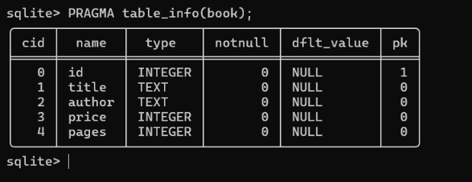
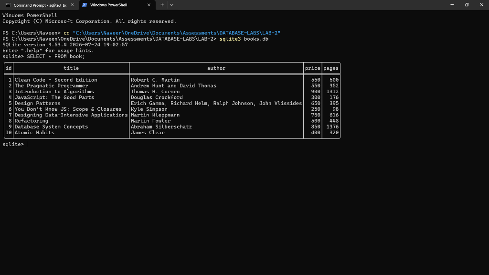
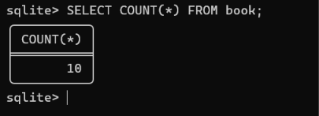
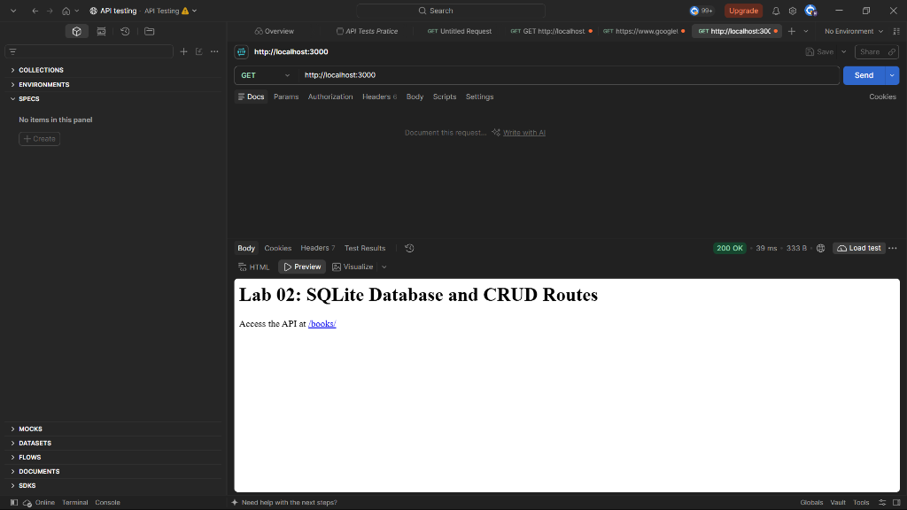
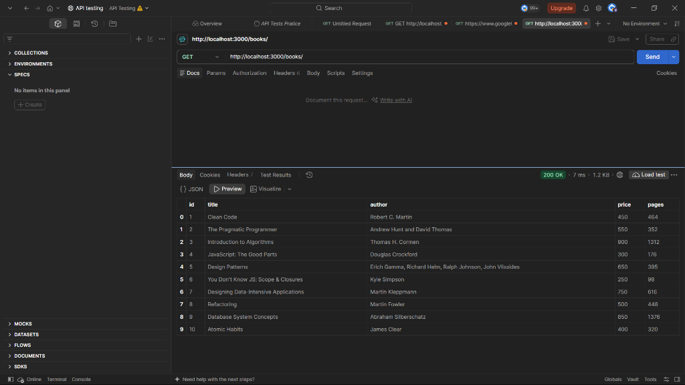
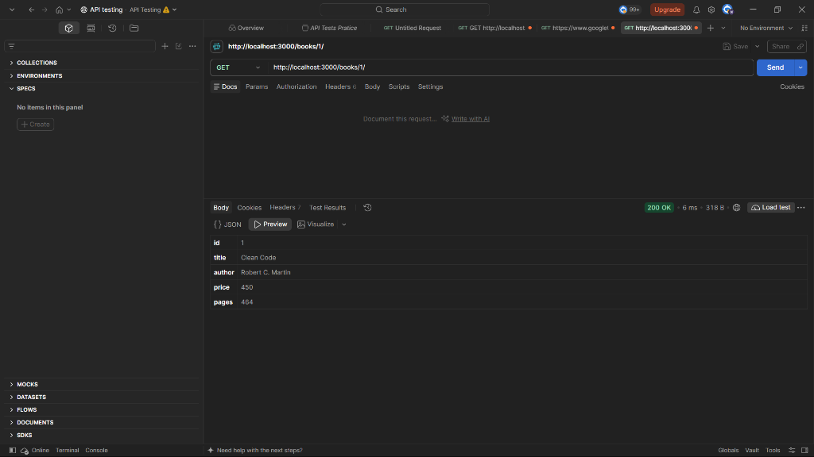
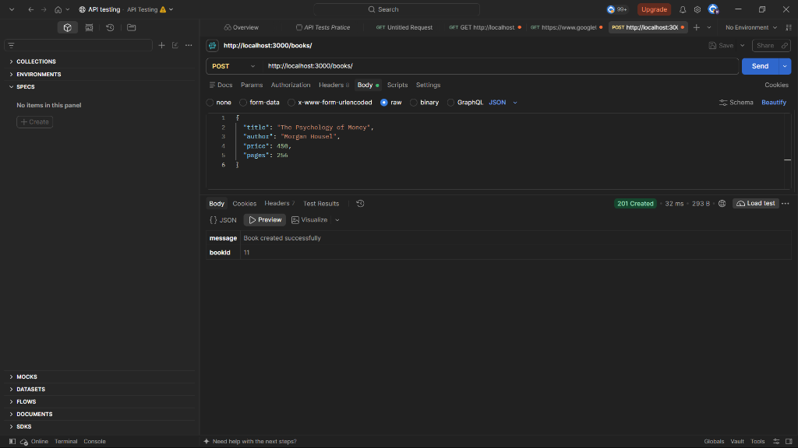
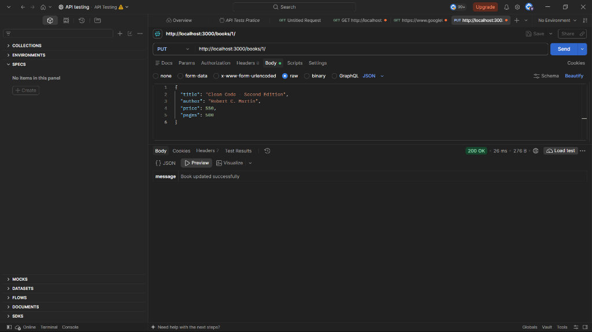

# Lab 02: SQLite Database and CRUD Routes

**Student Name:** Rajamoni Naveen  
**Registration Number:** 252U1R1210  
**Section:** CSE-2D  
**Course:** Backend Development Fundamentals (Year II Term II)

---

## Live Deployment

- **Live URL:** Not applicable (tested locally with Postman / SQLite CLI)

---

## Project Description

This project connects an Express.js backend to a local SQLite database (`books.db`) using promise-based SQLite wrappers (`sqlite` and `sqlite3`). It implements a complete set of CRUD (Create, Read, Update, Delete) RESTful API endpoints with parameterized queries, input validation, and standard HTTP response status codes.

---

## Technologies Used

- **Node.js** – Runtime environment
- **Express.js** – Web application framework
- **SQLite3 & SQLite** – Relational database engine and promise-based driver
- **Nodemon** – Development live-reload utility
- **Postman** – API testing and verification

---

## Database Schema and SQLite CLI Verification

### Table Schema
```sql
CREATE TABLE IF NOT EXISTS book (
    id INTEGER PRIMARY KEY,
    title TEXT,
    author TEXT,
    price INTEGER,
    pages INTEGER
);
```

### Table Structure Verification (`PRAGMA table_info(book);`)


### Database Records in SQLite CLI (`SELECT * FROM book;`)


### Record Count in SQLite CLI (`SELECT COUNT(*) FROM book;`)


---

## Installation & Setup

1. **Clone the repository and navigate to the project directory:**
   ```bash
   cd lab-02
   ```

2. **Install dependencies:**
   ```bash
   npm install
   ```

3. **Environment Variables:**
   - Optional: `PORT` (defaults to `3000` if not set)

---

## Running the Server

- **Development Mode (with auto-reload):**
  ```bash
  npm run dev
  ```

- **Production Mode:**
  ```bash
  npm start
  ```

---

## API Endpoints

| Method | Endpoint | Description | Status Codes |
|---|---|---|---|
| **GET** | `/` | Welcome and API navigation page | `200 OK` |
| **GET** | `/books/` | Retrieve all books | `200 OK`, `500 Internal Server Error` |
| **GET** | `/books/:bookId/` | Retrieve a single book by ID | `200 OK`, `404 Not Found`, `500 Internal Server Error` |
| **POST** | `/books/` | Add a new book | `201 Created`, `400 Bad Request`, `500 Internal Server Error` |
| **PUT** | `/books/:bookId/` | Update an existing book by ID | `200 OK`, `400 Bad Request`, `404 Not Found`, `500 Internal Server Error` |
| **DELETE** | `/books/:bookId/` | Delete a book by ID | `200 OK`, `404 Not Found`, `500 Internal Server Error` |
| **ALL** | `*` (any undefined route) | 404 handler for undefined routes | `404 Not Found` |

---

## Screenshots

### A. SQLite CLI Database Verification

#### 1. Table Schema (`PRAGMA table_info(book);`)


#### 2. All 10 Records in SQLite CLI (`SELECT * FROM book;`)


#### 3. Total Record Count (`SELECT COUNT(*) FROM book;`)


---

### B. Postman / API Endpoints Testing

#### 1. Root / Welcome Endpoint (`GET /`)
Shows the home landing response with the link to `/books/`.


#### 2. Get All Books (`GET /books/`)
Retrieves all 10 books from `books.db` in JSON format.


#### 3. Get Single Book by ID (`GET /books/1/`)
Retrieves the details of the book with `id = 1` (*Clean Code*).


#### 4. Create New Book (`POST /books/`)
Creates a new record (*The Psychology of Money*) and returns HTTP `201 Created` with the newly assigned `bookId: 11`.


#### 5. Update Book by ID (`PUT /books/1/`)
Updates book with `id = 1` (*Clean Code - Second Edition*) and returns HTTP `200 OK`.


#### 6. 404 Error Handler for Undefined Routes
Accessing any undefined route (e.g., `GET /unknown`) cleanly returns HTTP `404 Not Found` with structured JSON:
```json
{
  "error": "Not Found",
  "message": "Cannot GET /unknown"
}
```
*(If desired, add `` once captured in Postman/browser).*

---

## Learning Outcomes

- Initialized and configured an Express.js project with SQLite database integration.
- Designed and populated a relational SQLite database schema via the SQLite CLI.
- Implemented `initializeDBAndServer()` to ensure the server starts only after a successful database connection.
- Built parameterized SQL queries using `?` placeholders with `db.all()`, `db.get()`, and `db.run()` to prevent SQL injection vulnerabilities.
- Handled HTTP status codes accurately (`200 OK`, `201 Created`, `400 Bad Request`, `404 Not Found`, `500 Internal Server Error`).
- Validated request payloads before database mutations.

---

## Problems Faced and Solutions

1. **Root URL Returning `Cannot GET /` in Browser**
   - *Problem:* Visiting `http://localhost:3000` resulted in `Cannot GET /` because the lab endpoints are routed specifically under `/books/`.
   - *Solution:* Added a friendly root route `GET /` in `app.js` providing guidance and a direct link to `/books/`.

2. **Preventing SQL Injection in User Inputs**
   - *Problem:* String concatenation or template literals in SQL queries introduce security risks (SQL injection).
   - *Solution:* Used parameterized queries with `?` placeholders across all route handlers (`db.get(query, [bookId])`, `db.run(query, [title, author, price, pages])`).

3. **Reliable Database File Resolution**
   - *Problem:* Relative paths like `./books.db` fail when the Node process is launched from outside the project directory.
   - *Solution:* Utilized `path.join(__dirname, 'books.db')` to ensure the database file is always resolved relative to `app.js`.

4. **Sequential Asynchronous Database and Server Initialization**
   - *Problem:* Starting the Express server before SQLite finishes opening the database leads to unhandled database errors on incoming requests.
   - *Solution:* Encapsulated the setup inside `initializeDBAndServer()`, awaiting `open(...)` before executing `app.listen(PORT, ...)`.

